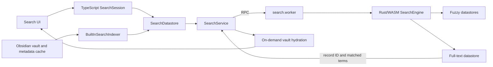

# Lemons Search Architecture

This document describes the current implementation for contributors. User-facing commands and query syntax belong in [README.md](README.md); planned changes belong in [FULL_TEXT_SEARCH_PLAN.md](FULL_TEXT_SEARCH_PLAN.md).

## System overview

Lemons Search keeps indexing and matching off Obsidian's UI thread. TypeScript owns vault integration and result hydration, while a web worker hosts the Rust/WASM search engine.

The parent repository consumes the Rust engine as the `packages/lemons-search` Git submodule. Production builds use the published `@lemons_dev/lemons-search` package; local WASM builds are selected with `LEMONS_SEARCH_LOCAL_WASM=true`.

## Component responsibilities

### Obsidian plugin and UI

The plugin creates separate built-in datastores for file paths, aliases, and full-text blocks. UI adapters hold a search session and render hydrated results; they do not directly access the WASM engine.

Relevant files:

- [main.ts](packages/obsidian/src/main.ts): plugin lifecycle, commands, and settings reactions.
- [SearchService.ts](packages/obsidian/src/searchWorker/SearchService.ts): worker ownership, RPC requests, and built-in datastore construction.
- [SearchDatastore.ts](packages/obsidian/src/searchWorker/SearchDatastore.ts): per-store mutation serialization, metadata policy, and owner replacement.
- [SearchSession.ts](packages/obsidian/src/searchWorker/SearchSession.ts): session lifetime and result hydration.

### Worker boundary

The worker initializes one `SearchEngine` and exposes it through a small request/response protocol. Store and session handles are opaque strings such as `store:1` and `session:1`; JavaScript never holds Rust references.

Mutations are serialized by each TypeScript `SearchDatastore`. Searches wait for that queue and for any active bulk load before calling the worker. Rust invalidates implementation-specific session caches whenever the corresponding store changes.

Relevant files:

- [search.worker.ts](packages/obsidian/src/searchWorker/search.worker.ts): WASM initialization and RPC handlers.
- [SearchWorkerRPCConfig.ts](packages/obsidian/src/searchWorker/SearchWorkerRPCConfig.ts): protocol types.
- [RPC.ts](packages/obsidian/src/rpc/RPC.ts): transport-independent message dispatch.
- [engine.rs](https://github.com/mProjectsCode/obsidian-lemons-search-wasm/blob/main/src/engine.rs): store/session registry and WASM exports.

## Datastore types

### Fuzzy datastores

File-path and alias search store one matcher-ready UTF-32 value per record. A `RecordTable` maps external IDs to reusable numeric slots. Each session retains its previous query and matching record indices so a strict query extension can rescore a narrower candidate set.

These stores return character ranges directly because the searchable display text is the indexed value.

### Full-text datastore

Full-text search indexes Markdown blocks rather than whole files. This keeps ranking and result previews focused on a local section and avoids retaining entire notes as result metadata.

The Rust index contains:

- a sparse `RecordTable<FullTextRecord>` with reusable `u32` record indices;
- a term-to-`u32` lookup map;
- a term catalog containing UTF-8 display text and matcher-ready UTF-32 text;
- one sorted posting vector per term;
- one `Posting { record_idx, term_frequency }` per live document-term pair;
- per-record token counts and unique term IDs for BM25 scoring and eager deletion.

The store tracks three distinct health values:

- `postingTerms`: catalog/posting-list slots, including currently empty terms;
- `postingEntries`: live document-term pairs and therefore actual `Posting` structs;
- `postingOccurrences`: token occurrences across live records.

Relevant Rust files:

- [full_text/mod.rs](https://github.com/mProjectsCode/obsidian-lemons-search-wasm/blob/main/src/stores/full_text/mod.rs): datastore state and public lifecycle surface.
- [full_text/index.rs](https://github.com/mProjectsCode/obsidian-lemons-search-wasm/blob/main/src/stores/full_text/index.rs): record mutation, term interning, and bulk loading.
- [full_text/exact_query.rs](https://github.com/mProjectsCode/obsidian-lemons-search-wasm/blob/main/src/stores/full_text/exact_query.rs): non-fuzzy parsing and catalog lookup.
- [full_text/query.rs](https://github.com/mProjectsCode/obsidian-lemons-search-wasm/blob/main/src/stores/full_text/query.rs): fuzzy term expansion, caching, and work budgets.
- [full_text/scoring.rs](https://github.com/mProjectsCode/obsidian-lemons-search-wasm/blob/main/src/stores/full_text/scoring.rs): BM25/fuzzy scoring and negation.
- [full_text/search.rs](https://github.com/mProjectsCode/obsidian-lemons-search-wasm/blob/main/src/stores/full_text/search.rs): group intersection, ranking, and result construction.
- [full_text/postings.rs](https://github.com/mProjectsCode/obsidian-lemons-search-wasm/blob/main/src/stores/full_text/postings.rs): sorted posting insertion and shared k-way traversal.
- [full_text/model.rs](https://github.com/mProjectsCode/obsidian-lemons-search-wasm/blob/main/src/stores/full_text/model.rs): stored records, terms, postings, and heap entries.
- [record_table.rs](https://github.com/mProjectsCode/obsidian-lemons-search-wasm/blob/main/src/core/record_table.rs): external IDs, sparse slots, and slot reuse.

## Full-text indexing lifecycle

`BuiltInSearchIndexer` builds path and alias indexes immediately, then schedules full-text indexing for idle time.

1. Markdown files are filtered through the configured exclusion policy.
2. The metadata cache divides each file into non-YAML sections. Files without sections fall back to one whole-file block.
3. `FullTextRecordIds` assigns the file a compact numeric owner ID and encodes owner and block offsets into each record ID.
4. The TypeScript side starts a bulk load, reads files in batches, and sends `{ id, text }` records to the worker.
5. Rust clears index data, appends postings during ingestion, and sorts posting lists when the bulk load finishes.
6. Searches remain unavailable until finalization restores posting-order invariants.

Vault create, modify, rename, and delete events schedule incremental owner replacement. The current replacement path deletes existing records by their compact owner prefix and then inserts the new blocks. The owner-aware atomic replacement described in the improvement plan is not implemented yet.

Relevant files:

- [BuiltInSearchIndexer.ts](packages/obsidian/src/searchWorker/BuiltInSearchIndexer.ts): rebuild scheduling, vault events, batching, and cancellation.
- [FullTextBlocks.ts](packages/obsidian/src/searchWorker/FullTextBlocks.ts): section records, compact IDs, hydration, and highlighting.

## Full-text query contract

Records are tokenized into lowercase Unicode alphanumeric terms. Every positive query atom must match a term in the same block. A match from any negative atom excludes the block, and a query containing only negative atoms returns no results.

### Fuzzy mode

Fuzzy mode uses Nucleo atoms with case-insensitive matching and smart Unicode normalization:

- `foo` performs fuzzy subsequence matching.
- `'foo` requires a substring.
- `^foo` requires a prefix.
- `foo$` requires a postfix.
- `^foo$` requires an exact term.
- `!` negates an atom.

Subsequence matching permits omitted characters. It does not provide general substitution or transposition tolerance. Smart normalization allows, for example, an unaccented query to match an accented catalog term.

For each atom, the implementation visits every live catalog term unless a search
session can safely narrow the previous atom's pre-budget candidate set. Before
running Nucleo, it rejects terms that cannot match based on matcher character
count and a compact case-folded/normalized character mask. These filters may
produce false positives from mask collisions, but never false negatives.

Matches scoring at least 70% of an atom's best fuzzy score are considered for a
deterministic expansion budget. Equal scores are ordered by normalized catalog
text rather than term ID. An exact catalog term is always retained; when there
is no exact term, the best candidate is retained. That mandatory posting list
may exceed the posting-entry budget by itself.

An atom is short when its matcher needle contains at most two characters. The
budgets are:

| Atom policy      | Maximum terms | Maximum posting entries |
| ---------------- | ------------: | ----------------------: |
| short positive   |            50 |                  10,000 |
| regular positive |           200 |                  50,000 |
| short negative   |           100 |                  20,000 |
| regular negative |           500 |                 100,000 |

These limits are an explicit approximate-recall policy and are covered by
behavior, insertion-order, exact-retention, and work-bound tests.

### Non-fuzzy mode

An unmodified atom must equal a complete term. `'` and `^` select substring and prefix matching, and `!` negates an atom. Postfix `$` syntax is not supported in this mode. Queries are case-insensitive because both indexed terms and parsed atoms are lowercased.

## Full-text scoring and ranking

Each expanded atom is an OR group of catalog terms; positive atom groups are intersected with AND semantics.

For each matching posting, the engine calculates BM25 from term frequency,
posting-list document frequency, block length, live document count, and average
block length. BM25 and fuzzy scores are normalized within the atom and blended
with a 30% BM25 / 70% fuzzy weight. Sorted posting lists are k-way merged into
one compact `(record index, best atom score)` vector. Positive vectors are
intersected from smallest to largest, with scores summed in place. Negative
posting streams are merged into a sorted exclusion vector. The query path does
not retain a hash table per atom or a global exclusion hash set.

Results are retained in a bounded heap. Heap admission and final output use the same total order:

1. score descending;
2. external record ID ascending.

The external-ID result tie-break and normalized-text expansion tie-break make
selection independent of hash iteration, record insertion order, term
insertion order, and record-slot reuse.

## Result hydration

Rust returns the block record ID, score, and matched catalog terms. Full note content is not retained as JavaScript metadata.

`hydrateFullTextDatum` decodes the record ID, resolves the current file, reads it through Obsidian's vault cache, slices the indexed block offsets, and derives highlight ranges from the matched terms. Missing or deleted files cause the result to be omitted or returned without content rather than retaining stale note text in the index.

## Configuration lifecycle

`SearchEngine` owns defaults that affect future stores, currently `max_results` and full-text fuzzy mode. Changing fuzzy mode updates the engine default and all existing full-text stores. Clearing or rebuilding a full-text store removes index data but preserves its configuration.

`SearchService` sends persisted engine settings after worker initialization and before built-in datastore creation. This ordering ensures the first full-text store inherits the user's saved mode.

## Correctness invariants

Changes to the search engine must preserve these invariants:

- external IDs uniquely identify live records within a store;
- a reusable record slot cannot leave postings that refer to its previous record;
- queryable posting lists are sorted by `record_idx`;
- searches do not run against an unfinished bulk load;
- every mutation invalidates affected session caches;
- token counts, posting-entry counts, and occurrence counts reflect live records;
- top-K heap admission and final sorting use the same rank order;
- full-text configuration survives clear and rebuild operations.

## Testing and benchmarks

The parent repository uses Bun for TypeScript tests, typechecking, linting, and formatting. The WASM repository uses Rust unit tests plus `wasm-pack test --node` for the JavaScript boundary.

Full-text benchmarks use deterministic generated blocks and independently cover bulk build, small/medium/large record updates, repeated edit/delete cycles, and exact, fuzzy, short, long, incremental, multi-atom, negative, and no-match queries. Run them from the submodule with `make bench`; use `BENCH_FILTER` for one workload and `LEMONS_BENCH_CASES`/`LEMONS_BENCH_QUERIES` to select compile-time sizes.

The Rust global allocator records requested live allocation bytes and a resettable peak. Committed WASM linear-memory bytes are reported separately because pages generally do not shrink after deallocation. `make baseline` emits workload metadata, build throughput, latency distributions, both memory measurements, and density ratios. The first named-environment result and numeric regression budgets are retained in [benchmarks/full-text-baseline-2026-06-28.md](benchmarks/full-text-baseline-2026-06-28.md).

Full-text sessions retain each parsed atom's pre-cap vocabulary matches and
scores. A later query may rescore only those candidates when the same fuzzy,
prefix, or substring atom gains trailing codepoints; those matcher modes are
monotonic under the full-text case/normalization configuration. Exact and
postfix atoms always rescan because extension can change their boundary match.
All datastore mutations, clears, rebuilds, and fuzzy-mode changes invalidate
the session state.
